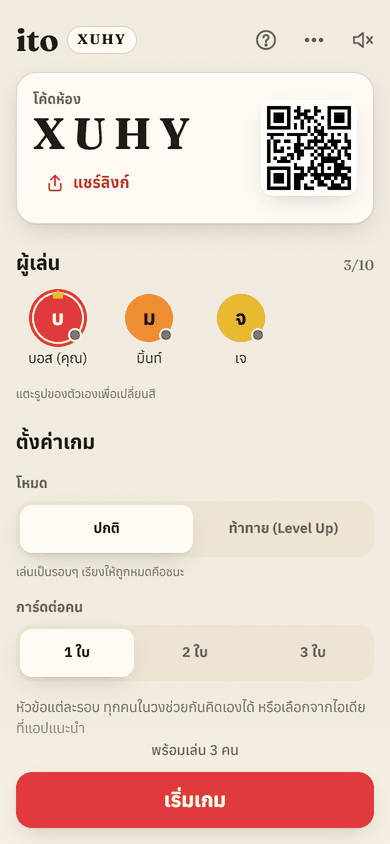
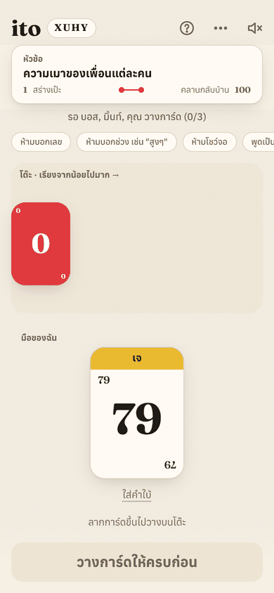
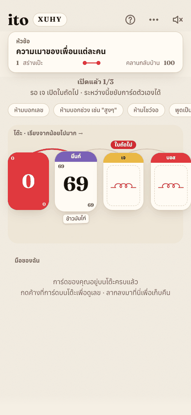

<h1 align="center">ito</h1>

<p align="center">
  <b>Line up your thoughts.</b><br/>
  A web app for playing <i>ito</i> with friends around the same table — every phone is a card, and the fun happens face to face.
</p>

<p align="center">
  
  
  
</p>

## How it plays

1. **Everyone gets a secret number from 1 to 100.** Press and hold your card to peek. Never say it out loud.
2. **Pick a topic**, like "how spicy is this food". Describe your number with an example instead ("90? Tom yum.").
3. **Sort together, lowest to highest.** Drag your face-down card onto the shared table, starting after the red 0.
4. **Flip one card at a time, from the left.** The owner flips their own card, and everyone can still rearrange the rest. A card lower than the one before it breaks the thread.

It's cooperative — the whole table wins or loses together. 2–10 players.

## A quick tour

<table>
  <tr>
    <td align="center"></td>
    <td align="center"></td>
    <td align="center"></td>
  </tr>
  <tr>
    <td align="center"><b>Join in seconds</b><br/><sub>No sign-up. Share a 4-letter code, a QR code or a link.</sub></td>
    <td align="center"><b>Your own topics</b><br/><sub>Anyone can write one. Stuck? Scroll ideas, or hit random.</sub></td>
    <td align="center"><b>Press and hold to peek</b><br/><sub>The number hides the moment you let go or switch apps.</sub></td>
  </tr>
  <tr>
    <td align="center"></td>
    <td align="center"></td>
    <td align="center"></td>
  </tr>
  <tr>
    <td align="center"><b>The red thread</b><br/><sub>Each flip draws the thread on. A wrong card snaps it.</sub></td>
    <td align="center"><b>Your turn, your flip</b><br/><sub>Talk it over, rearrange, then flip when the table is ready.</sub></td>
    <td align="center"><b>Level Up mode</b><br/><sub>Three hearts, more cards every level. Dark mode included.</sub></td>
  </tr>
</table>

## Also

- **Fair by design.** The server never sends anyone else's number to your phone until it's flipped.
- **Real-time.** Everyone sees every move live, and a dropped phone rejoins where it left off.
- **Feels like paper.** Tactile cards, sound and haptics, light and night-table themes.
- **Installable.** Add it to your home screen like an app (PWA).

## Try it

**Play online:** _(link coming after deploy)_ — open it on your phone, enter a nickname, create a room, and let friends scan the QR.

**Run locally** (Node 22 + Docker):

```bash
npm install
npx supabase start   # local database; copy its keys into .env.local (see .env.example)
npm run dev          # http://localhost:5173
```

Connecting a real Supabase project, deploying, and running the tests: [docs/SETUP.md](docs/SETUP.md).

---

<sub>Built with Vite, React, TypeScript, Tailwind CSS and Supabase. The interface is in Thai.</sub>
