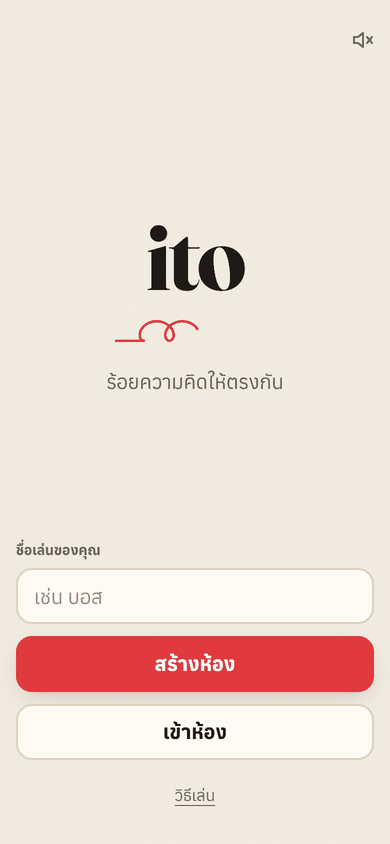
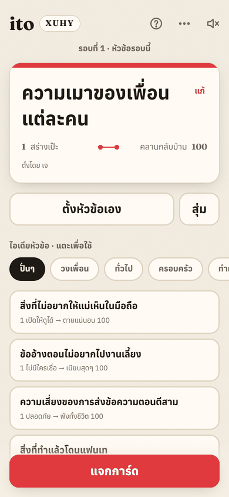
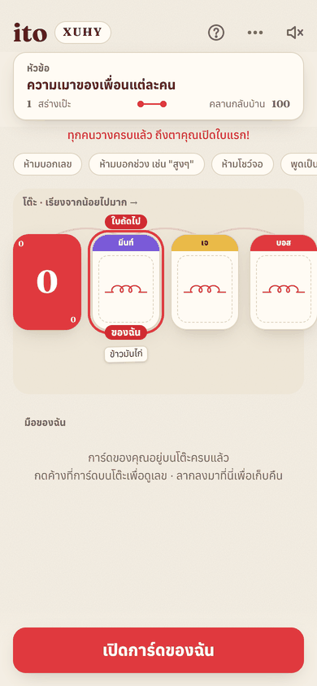
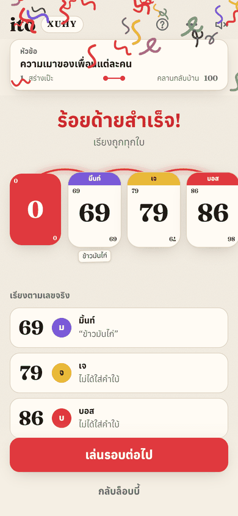
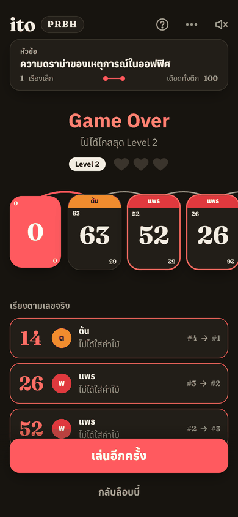

<h1 align="center">ito</h1>
<p align="center"><b>ร้อยความคิดให้ตรงกัน</b><br/>เกม ito สำหรับเล่นกับเพื่อนในวงจริง ทุกคนใช้มือถือตัวเองเป็นการ์ด</p>

<p align="center">
  
  
  
  
</p>

## เล่นยังไง

1. **ทุกคนได้เลขลับ 1–100** กดค้างที่การ์ดเพื่อแอบดู ห้ามบอกใคร
2. **ตั้งหัวข้อ** เช่น "ความเผ็ดของอาหาร" แล้วพูดเป็นตัวอย่างแทนตัวเลข (ได้ 90 อาจพูดว่า "ต้มยำ")
3. **ช่วยกันเรียงจากน้อยไปมาก** ลากการ์ดคว่ำของตัวเองไปวางบนโต๊ะ
4. **เปิดทีละใบจากซ้าย** เจ้าของการ์ดเป็นคนเปิดเอง เปิดแล้วยังเรียงใบที่เหลือใหม่ได้ ใบไหนน้อยกว่าใบก่อนหน้า ด้ายขาด

เป็นเกมร่วมมือ ทุกคนอยู่ทีมเดียวกัน เล่นได้ 2–10 คน

## มีอะไรบ้าง

- **ไม่ต้องสมัคร** สร้างห้องแล้วให้เพื่อนเข้าด้วยโค้ด 4 ตัว, QR หรือลิงก์
- **หัวข้อตั้งเองได้** ใครในวงก็คิดได้ ถ้าตันมีไอเดียให้เลื่อนดู รวมถึงหมวด "ปั่นๆ" สำหรับวงเหล้า
- **โหมดท้าทาย (Level Up)** มี 3 หัวใจ เลเวลยิ่งสูงยิ่งได้การ์ดเยอะ
- **เลขลับปลอดภัยจริง** เซิร์ฟเวอร์ไม่ส่งเลขของคนอื่นมาที่เครื่องเราจนกว่าจะเปิด
- **ติดตั้งเป็นแอปบนมือถือได้ (PWA)** มีโหมดกลางคืน เสียง และการสั่น

<p align="center">
  
</p>

## ลองใช้

**เล่นออนไลน์:** _(ใส่ลิงก์หลัง deploy)_ เปิดบนมือถือ → ใส่ชื่อ → สร้างห้อง → ให้เพื่อนสแกน QR

**รันในเครื่อง** (ต้องมี Node 22 และ Docker)

```bash
npm install
npx supabase start   # ฐานข้อมูลในเครื่อง แล้วใส่ค่าใน .env.local ตาม .env.example
npm run dev          # เปิด http://localhost:5173
```

วิธีเชื่อม Supabase จริง, deploy และรันเทส ดูที่ [docs/SETUP.md](docs/SETUP.md)

---

<sub>Vite · React · TypeScript · Tailwind · Supabase · ออกแบบในธีม "ด้ายแดง"</sub>
